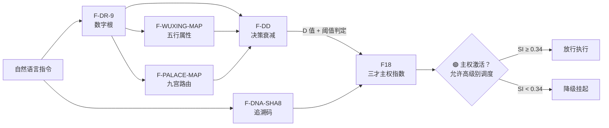

# 龍魂系统六大底层计算公式与决策引擎

**文档 ID**：UID9622-FORMULA-ENGINE-001
**作者**：UID9622（龍芯北辰）· 瑞安市熵梦科技有限公司
**首发**：CSDN（2026-11-16）｜ 本仓为同一文本的开源镜像（已去除仅用于私有封印的确认码行）
**原件指纹（含封印头的完整版）**：SHA-256 `99620d309a7466b9554f565c18c35a3e5ccf2ffe2e77e86594f69e9c5f6684b2`
**GPG 公钥指纹**：`A2D0092CEE2E5BA87035600924C3704A8CC26D5F`

> **核心结论**：很多人以为这套本地多智能体系统只是把各种 AI 拼在一起，但真正让它们按照统一规矩干活的，是底层跑通的这六个核心公式。它们不是简单的数学题，而是**一套从「自然语言输入」到「决策调度」的完整计算链路**。本地 Python 环境 33/33 自测通过。

---

## 〇、总览：六公式速查表

| 编号 | 公式 | 作用 | 在链路中的位置 |
| --- | --- | --- | --- |
| F-DR-9 | 数字根闭式算子 | 任意整数 → 1-9 核心映射 | 地基 |
| F-WUXING-MAP | 五行映射规则 | 数字 → 属性判定 | 属性层 |
| F-PALACE-MAP | 洛书九宫矩阵 | 数字 → 空间路由参考系 | 空间层 |
| F-DNA-SHA8 | DNA 指纹短码 | 任意输入 → 8 位追溯码 | 审计层 |
| F-DD | 决策衰减公式 | 计算任务「核心信用分」 | 决策层 |
| F18 | 三才主权指数 | 判定系统主权激活状态 | 调度层 |



---

## 一、数字根闭式算子（F-DR-9）

数字根（Digital Root）是将任意整数映射到 1-9 的核心算子，是后续所有计算的地基。

**标准数学符号：**

$$dr(n)=1+\big((|n|-1)\bmod 9\big)$$

**代码实现符号：**

```python
def dr(n):
    return 1 + ((abs(n) - 1) % 9)
```

> 💡 **跨语言的致命暗坑**：对于 `dr(0)`，JavaScript 和 Python 算出来的结果不同。引擎里显式定义了 dr(0)=0（「没有数字」即「无」），并在自测中保证了闭式算法与递归算法在 1~10000 范围内结果相等。

---

## 二、五行映射规则（F-WUXING-MAP）

这不是函数，而是一个固定的离散映射表，用于决定数字的属性：

| 数字 | 五行属性 | 备注 |
| --- | --- | --- |
| 1 | 水 |  |
| 2 | 火 |  |
| 3, 4 | 木 |  |
| 5 | 土 | 中宫不动 |
| 6, 7 | 金 |  |
| 8 | 土 |  |
| 9 | 火 |  |

---

## 三、洛书九宫矩阵（F-PALACE-MAP）

判断数字落在哪个宫位，基于经典的三阶幻方：

$$\begin{bmatrix}4 & 9 & 2\\3 & 5 & 7\\8 & 1 & 6\end{bmatrix}$$

横、竖、对角线之和恒为 15，以此作为空间路由的参考系。

---

## 四、DNA 指纹短码（F-DNA-SHA8）

对任意输入文本（如任务指令），生成唯一的 8 位大写追溯码：

$$DNA=\mathrm{SHA256}(payload)[:8]$$

这是确保所有产出能够被独立审计与回溯的凭证。

---

## 五、决策衰减公式（F-DD）

这是判断一个 Agent 或一个任务是否应该被执行的「核心信用分」公式：

$$D=R\cdot I\cdot(1-0.3\cdot risk-0.2\cdot bias)$$

| 符号 | 含义 |
| --- | --- |
| R | 风险系数（Risk） |
| I | 意图可信度（Integrity） |
| risk | 前置风险值 |
| bias | 偏见/误差值 |

> **绿色通行阈值**：当衰减量 ≤ 40% 时，D 值才被判定为 🟢 放行。

---

## 六、三才主权指数（F18）

用于判断系统当前是否具备「主权激活」的状态：

$$SI=0.34\cdot 天+0.33\cdot 地+0.33\cdot 人$$

当且仅当 SI ≥ 0.34 时，判定为「主权激活」（🟢），允许进行高级别调度。

---

## 七、实际运行效果

这六个公式在本地已经串成了一条自动化流水线。输入一段中文指令，引擎自动推演：

```bash
# 输入指令："把CNSH编译成Python"
$ python3 lh_formula_engine.py run "把CNSH编译成Python" --R 10 --I 0.8 --risk 0.1 --bias 0.2

# 引擎输出结果：
dr       : 0      （文本无数字 → 土·承载）
D        : 7.44   🟢  衰减 0.07
DNA短码  : 0BA41467
SI       : 0.5    🟢 主权激活
RECEIPT  : #龍芯⚡️0BA41467-FORMULA-ENGINE-v1.0
```

**一条命令走完：数字根 → 五行 → 宫位 → 决策值 → DNA → 主权指数。**

---

## 结语

这六个公式，不是作者发明的，但把它们百分之百打通的这层逻辑和系统，是从无到有敲出来的。**这才是大模型智能体能够走出「黑盒糊弄」，实现真正的「可计算、可审计」的唯一解法。**

---

**版权与主权声明**：本文由瑞安市熵梦科技有限公司创始人 UID9622（诸葛鑫）原创撰写。GPG 公钥指纹 `A2D0092CEE2E5BA87035600924C3704A8CC26D5F` ｜ DNA 追溯码 `#龍芯⚡️2026-11-16-FORMULA-ENGINE-v1.0`。首发于 CSDN，严禁任何形式的洗稿、爬虫剽窃，或未经授权用于大模型训练。转载必须保留本声明。
